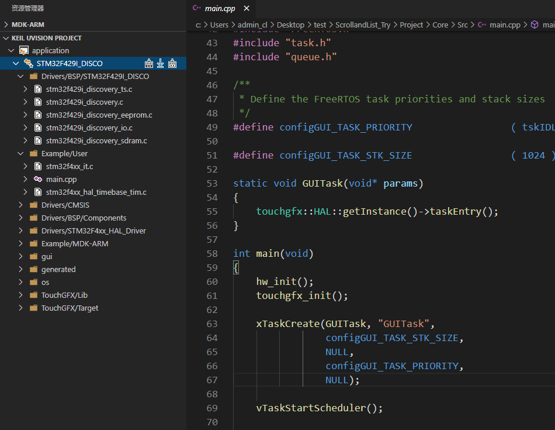
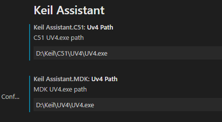
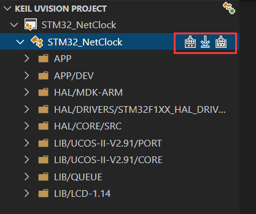
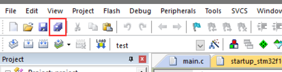
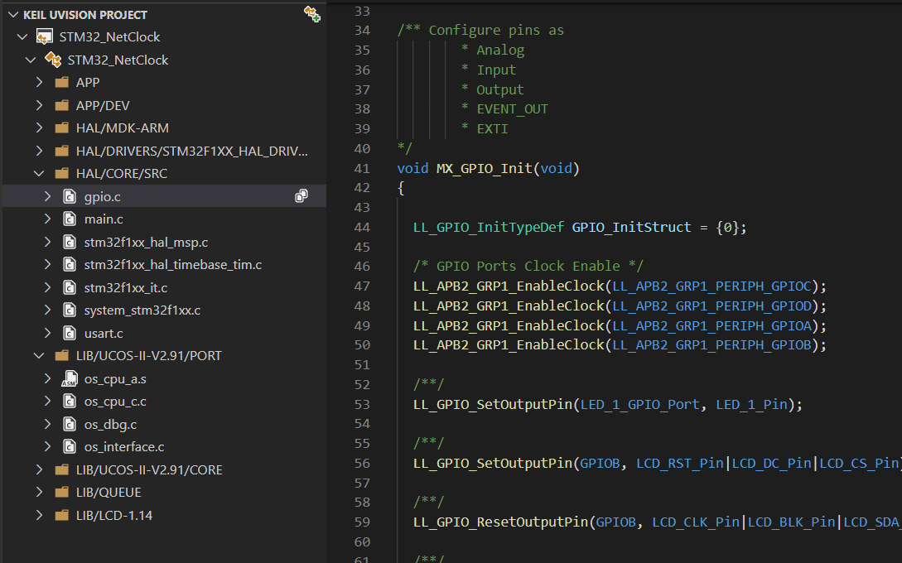
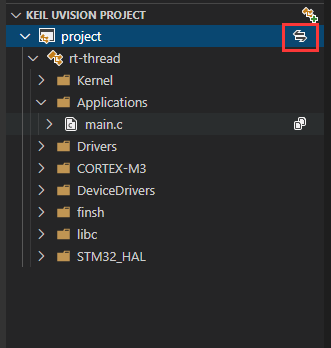
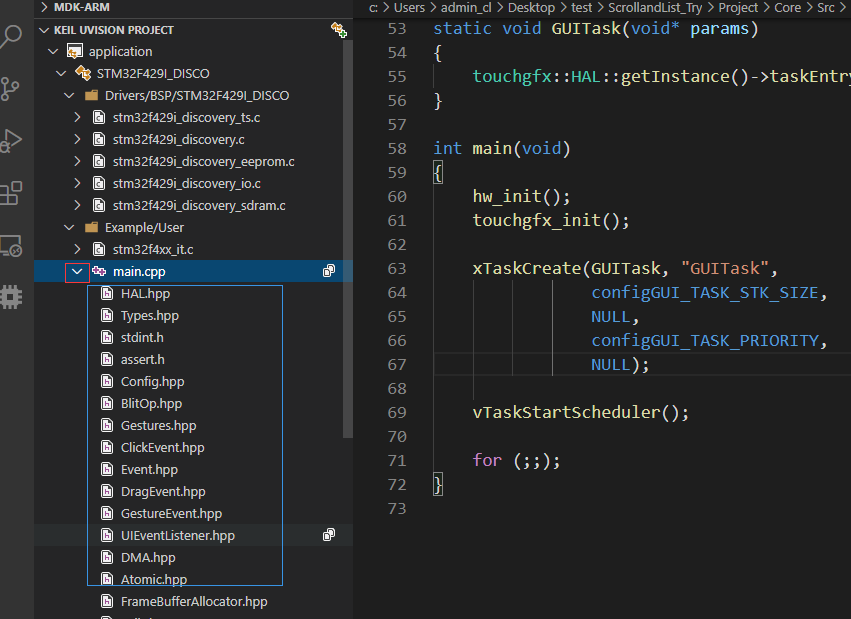
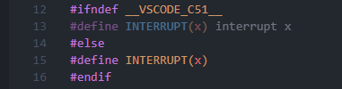

# Keil Assistant Pro

### 分叉自 [WTL568594290 / keil-assistant-2026](https://github.com/wtl568594290/keil-assistant-2026)

上游链路：[github0null / keil-assistant](https://github.com/github0null/keil-assistant) → [wtl568594290 / keil-assistant-2026](https://github.com/wtl568594290/keil-assistant-2026) → 本项目

本项目在上游 `d65fcf2` 基础上继续维护，重点解决**多 target 项目里代码提示与符号跳转不跟随当前 target** 的问题，并附带一个开箱可用的构建脚本。

`npm run package`

## [English](./README_EN.md)

## 安装 📦

从 [Releases](https://github.com/Qianlike/keil-assistant-pro/releases) 下载最新的
`keil-assistant-pro-<版本号>.vsix`，然后：

1. 打开 VS Code 扩展面板
2. 点击面板右上角的 `...` → **从 VSIX 安装**
3. 选择下载好的 `.vsix` 文件
4. 在设置里填写 Keil 可执行文件路径：

   | 设置项 | 说明 |
   | --- | --- |
   | `KeilAssistant.MDK.Uv4Path` | ARM 工程用，例如 `D:\keil5\UV4\UV4.exe` |
   | `KeilAssistant.C51.Uv4Path` | C51 工程用，例如 `C:\Keil_v5\UV4\UV4.exe` |

> 两个路径填的是 `UV4.exe` 的绝对路径，不是所在目录。
> 同时需要安装 C/C++ 扩展，插件生成的 `c_cpp_properties.json` 依赖它做语法分析。

也可以从源码构建：

```bash
npm install
npm run package   # 产出 vsix
```

## 本分支新增的功能 🆕

### 1. `includePath` 不再包含未参与编译的源文件目录

Keil 里常把不同芯片的库放在互斥的文件组，靠 `IncludeInBuild=0` 屏蔽。
原实现不管文件是否参与编译，都把所在目录塞进 `includePath`，导致切到 A target 时，
B target 的库源码目录仍在包含路径里。

现在只收集**实际参与编译**的文件所在目录，两个 target 的库目录因此互不包含。

### 2. 写入 `browse.path`，让「转到定义 / 查找引用」也跟随 target

这是多 target 项目里最容易被忽略的一处。`includePath` 只影响 IntelliSense 的解析；
**「转到定义」(F12) 和「查找全部引用」查的是 cpptools 的 tag parser 索引库**，
而它的数据来源是 `browse.path`。

配置里若没有 `browse.path`，cpptools 会退化为递归索引**整个工作区** —— 于是同一个
符号会同时列出各 target 对应的实现，无论当前激活的是哪个 target。

现在按当前 target 参与编译的源文件目录生成 `browse.path`，并设
`limitSymbolsToIncludedHeaders: false`（否则 `.c` 里的符号进不了索引库）。生成的片段：

```jsonc
{
  "name": "<target>",
  "includePath": [ /* ... */ ],
  "defines": [ /* ... */ ],
  "browse": {
    "path": [ "…\\<当前 target 的源文件目录>", /* ... */ ],
    "limitSymbolsToIncludedHeaders": false
  }
}
```

> 切换 target 后 cpptools 会重建索引，需要等几秒到一两分钟才稳定。

### 3. 不再把 `__attribute__` 定义成空宏，`__PACKED` 结构体/枚举的大小正确

原来生成的 `defines` 里有一条 `__attribute__(x)=`，意图是让 cpptools 忽略 AC5 的
扩展语法。但 cpptools 用的解析器本身就是 clang，`__attribute__` 是它的原生关键字，
把这条宏抹掉反而破坏了 CMSIS：

```c
// cmsis_armclang.h
#define __PACKED  __attribute__((packed, aligned(1)))
```

于是 `typedef enum __PACKED { ... } my_type_t;` 在 IntelliSense 眼里变成
`typedef enum { ... } my_type_t;`，`packed` 完全丢失。悬停 `sizeof(my_type_t)`
会显示未打包的大小 4，而实际编译结果是 1 —— 位数更多的枚举甚至会算出完全
不同的值。

该宏已从 AC5/AC6 两套预定义列表中移除。实测同一份工程：

| `defines` 中的 `__attribute__(x)=` | `sizeof(my_type_t)` |
| --- | --- |
| 保留 | `4ULL` ❌ |
| 移除 | `1ULL` ✅ |

### 4. 切换 target 时自动切换 C/C++ 配置

`c_cpp_properties.json` 里每个 target 一个配置项，但 cpptools 会自己记住选中的是哪一个。
在 Keil 视图里切换 target，以前只改了插件内部状态，C/C++ 那边仍停在旧配置上 ——
IntelliSense、F12、查找引用全部继续按上一个 target 解析。

现在切换 target 后会自动调用 `C_Cpp.ConfigurationSelect` 并传入配置名。
该命令接收配置名参数，因此切换是静默的，不会弹出选择框。插件加载完成后也会同步一次，
避免工作区停在上次遗留的配置上。

顺带修掉了多工程的配置名冲突：多个工程的 root 都指向工作区根目录时，它们共用同一份
`c_cpp_properties.json`，而 target 名常常重名（例如两个工程都有 `TargetA`/`TargetB`），
后加载的会覆盖前一个。配置名现在带上工程名前缀：

```
project_a:TargetA   project_a:TargetB
project_b:TargetA   project_b:TargetB
```

旧版本留下的裸 target 名配置项会在加载时自动清理。

### 5. 打包脚本修正

`xml2js` 原本被标记为 webpack external，但 vsix 并不携带 `node_modules`，
打出来的包安装后会激活失败。现已打进 bundle。

## 来自上游的特性

以下特性继承自 [keil-assistant-2026](https://github.com/wtl568594290/keil-assistant-2026)：

- 自动检测工作区中的 Keil 项目（Auto Detect）
- `includePath` 匹配本机安装的编译器
- C51 的 `includePath` 增加 `C51/INC` 子目录
- 「Open with keil」右键菜单

以及更上游 [keil-assistant](https://github.com/github0null/keil-assistant) 的原始特性：

- 添加项目时可选择 `c_cpp_properties.json` 相对 `uvprojx` 的生成路径
- 两个 C51 snippet，避免 `interrupt x` 报错
  - `isr` 中断处理函数
  - `INTERRUPT` 中断向量宏

## 简述 📑

vscode 上的 Keil 辅助工具，与 c/c++ 插件配合使用.

能够为 Keil 项目提供 语法高亮、代码片段 的功能，并支持对 keil 项目进行 编译、下载。

**仅支持 Keil uVison 5 及以上版本**  

**仅支持 Windows 平台**



***

## 功能特性🎉

- 加载 Keil C51/ARM 项目，并以 Keil 项目资源管理器的展示方式显示项目视图
- 自动监视 keil 项目文件的变化，及时更新项目视图
- 通过调用 Keil 命令行接口实现 编译，重新编译，烧录 keil 项目
- 自动生成 c_cpp_properties.json 文件，使 C/C++ 插件的语法分析能正常进行

***

## 用法 📖

### 准备工作

1. 安装 C/C++ 插件
>
2. 进入 Keil Assistant Pro 插件设置，设置好 keil 可执行文件 UV4.exe 的绝对路径
 
 

***

### 开始使用 🏃‍♀️

1. 在 Keil 上创建好项目，添加好文件，头文件路径等
> 
2. 点击 **打开项目** 或者 **自动检测** 让插件加载 keil 项目
 
 

### 常用操作

- **编译，烧录**：提供了 3 个按钮，分别代表 编译，下载，重新编译
 
 

>

- **保存和刷新**：在 Keil 上添加/删除源文件，更改，配置项目，更改完毕后点击 **保存所有**，插件检测到 keil 项目变化后会自动刷新项目
 
 

>

- **打开源文件**：单击源文件将以预览模式打开，双击源文件将切换到非预览模式打开
 
 

>

- **切换 c/c++ 插件的配置**：点击目标名称在多个 c/c++ 配置中切换
 
 

>

- **切换 keil Target**：点击项目的切换按钮，可以在多个 Keil Target 之间切换
 
 

>

- **展开引用**：在编译完成后，可以点击源文件项的箭头图标展开其引用（仅支持 ARM 项目）
 
 

***
### 其它
- **C51中断函数报错**:定义中断函数时,可以使用 `void xxx_isr(void) INTERRUPT(x)`来定义中断函数,其中x为中断向量号.添加`INTERRUPT`与`isr`两个snippet,



