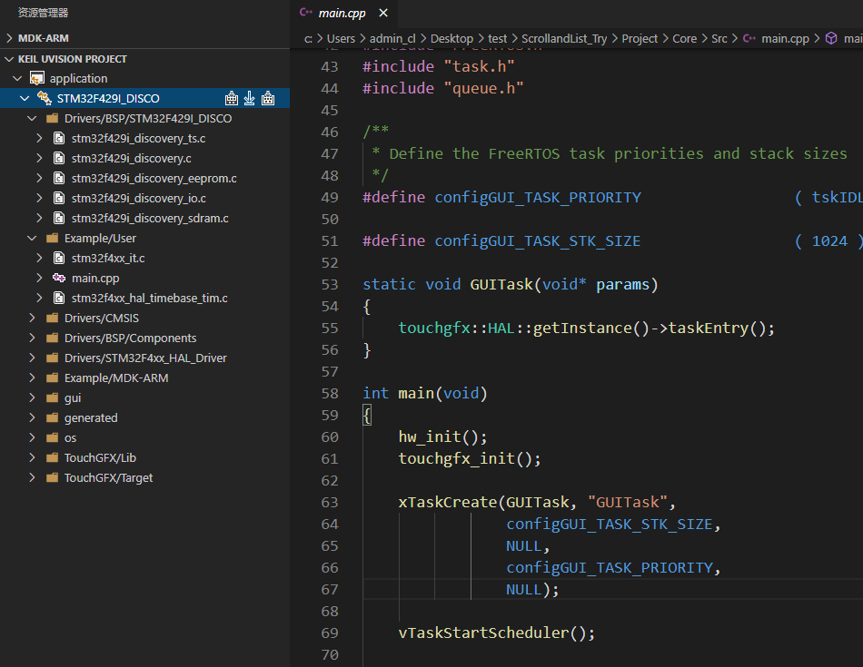
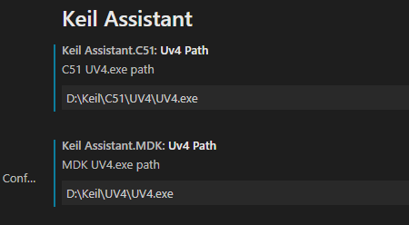
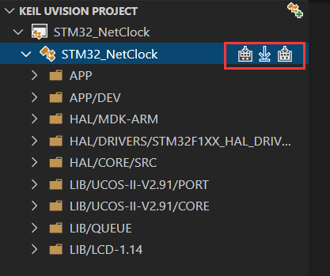
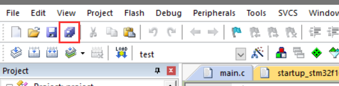
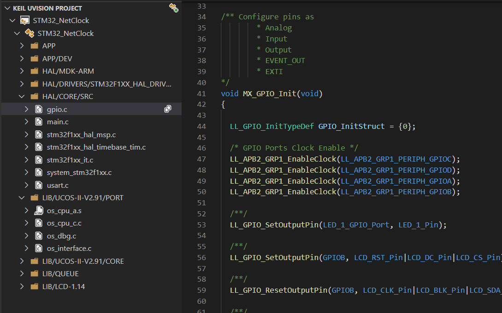
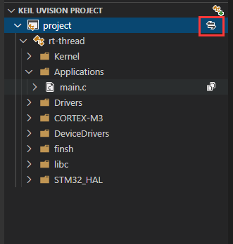
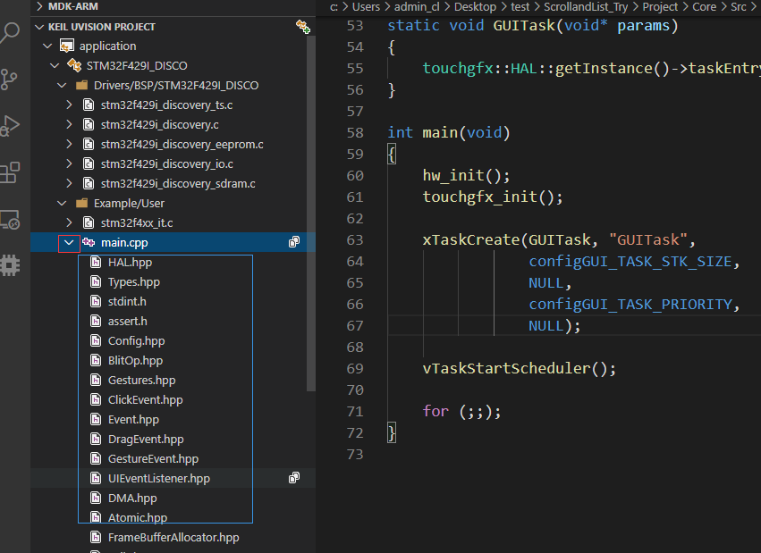
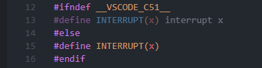

# Keil Assistant Pro

### Forked from [WTL568594290 / keil-assistant-2026](https://github.com/wtl568594290/keil-assistant-2026)

Upstream chain: [github0null / keil-assistant](https://github.com/github0null/keil-assistant) → [wtl568594290 / keil-assistant-2026](https://github.com/wtl568594290/keil-assistant-2026) → this project

This project continues from upstream `d65fcf2`, focusing on making **IntelliSense and
symbol navigation follow the active target** in multi-target projects, plus a fixed build script.

`npm run package`

## What this fork adds 🆕

### 1. `includePath` no longer contains folders that are not part of the build

Keil projects commonly keep the libraries of different chips in mutually exclusive file
groups, disabled with `IncludeInBuild=0`. The original implementation added a folder to
`includePath` regardless of whether its files were compiled, so the other target's library
sources stayed on the include path.

Only folders of files that **actually take part in the build** are collected now, so two
targets no longer see each other's library folders.

### 2. `browse.path` is written, so Go to Definition / Find All References follow the target

This is the easily missed half of the problem. `includePath` only drives IntelliSense
parsing; **Go to Definition (F12) and Find All References query the cpptools tag parser
database**, which is fed from `browse.path`.

When `browse.path` is absent, cpptools falls back to indexing the **entire workspace**
recursively — so the same symbol lists the implementations of every target, no matter
which one is active.

`browse.path` is now generated from the folders of the active target's compiled sources,
with `limitSymbolsToIncludedHeaders: false` (otherwise symbols defined in `.c` files never
reach the tag database):

```jsonc
{
  "name": "<target>",
  "includePath": [ /* ... */ ],
  "defines": [ /* ... */ ],
  "browse": {
    "path": [ "…\\<source folders of the active target>", /* ... */ ],
    "limitSymbolsToIncludedHeaders": false
  }
}
```

> cpptools rebuilds its index after a target switch; allow a few seconds to a minute.

### 3. `__attribute__` is no longer stubbed out, so `__PACKED` types have the right size

The generated `defines` used to contain `__attribute__(x)=`, meant to make cpptools
tolerate the AC5-specific syntax. But cpptools parses with clang, where
`__attribute__` is a native keyword, and blanking it breaks CMSIS:

```c
// cmsis_armclang.h
#define __PACKED  __attribute__((packed, aligned(1)))
```

So `typedef enum __PACKED { ... } my_type_t;` reached IntelliSense as
`typedef enum { ... } my_type_t;` — the `packed` qualifier was gone. Hovering
`sizeof(my_type_t)` reported the unpacked size (4, say) while the compiler really
emits 1; for enums with larger values the numbers differ entirely.

The macro has been removed from both the AC5 and the AC6 predefined lists. Measured on
the same project:

| `__attribute__(x)=` in `defines` | `sizeof(my_type_t)` |
| --- | --- |
| present | `4ULL` ❌ |
| removed | `1ULL` ✅ |

### 4. Packaging fix

`xml2js` was marked as a webpack external, but a vsix does not ship `node_modules`, so the
packaged extension failed to activate. It is bundled now.

## Features inherited from upstream

From [keil-assistant-2026](https://github.com/wtl568594290/keil-assistant-2026):

- Auto-detect Keil projects in the workspace
- `includePath` matched against the compiler installed on this machine
- C51 `includePath` includes the `C51/INC` subdirectory
- "Open with keil" context menu entry

From the original [keil-assistant](https://github.com/github0null/keil-assistant):

- Optionally generate `c_cpp_properties.json` relative to the `uvprojx`
- Two C51 snippets to avoid `interrupt x` errors
  - `isr` interrupt handler function
  - `INTERRUPT` interrupt vector macro

## Summary 📑

Keil assistive tool on VScode, used with C/C++ plug-in.

It provides syntax highlighting, code snippets for Keil projects, and supports compiling and downloading Keil projects.

**Keil uVison 5 and above is supported only**  

**Windows platform only**



***

## Features 🎉

- Load the Keil C51/ARM project and display the project view as the Keil project style
- Automatically monitor keil project files for changes and keep project views up to date
- Compile, recompile, and burn Keil projects by calling the Keil command-line interface
- Automatically generate c_cpp_property.json for C/C++ plug-in

***

## Usage 📖

### Preparatory work

1. Install the C/C++ plug-in
>
2. Go to the Keil Assistant Pro plug-in Settings and set the absolute path of the Keil executable uv4.exe
 
 

***

### Start 🏃‍♀️

1. Create a project on Keil, add files, header path, etc
> 
2. Click **Open the Project** icon or **Auto Detect** to load the keil project by the plug-in
 
 

### Common operations

- **Compile and burn**：Three buttons are provided, one for compile, one for download, and one for recompile
 
 

>

- **Save and refresh**：Add/delete the source file, change and configure the project on Keil. Click **Save all** when the change is finished. The plug-in will automatically refresh the project when it detects the change of the Keil project
 
 

>

- **Open source file**：Clicking the source file will open it in preview mode, and double-clicking the source file will switch it to non-preview mode
 
 

>

- **Toggle the C/C++ plug-in configuration**：Click the target name to toggle between multiple C/C++ configurations
 
 

>

- **Switch keil Target**：Click the project toggle button to toggle between multiple Keil targets
 
 

>

- **Show reference**：After compilation is complete, you can expand the reference by clicking on the arrow icon for the source item (ARM project only)
 
 

***
### Others
- **C51 Interrupt Function Error**: When defining an interrupt function, you can use `void xxx_isr (void) INTERRUPT (x)` to define the interrupt function, where x is the interrupt vector number. Add two snippets, `INTERRUPT` and `ISR`,



